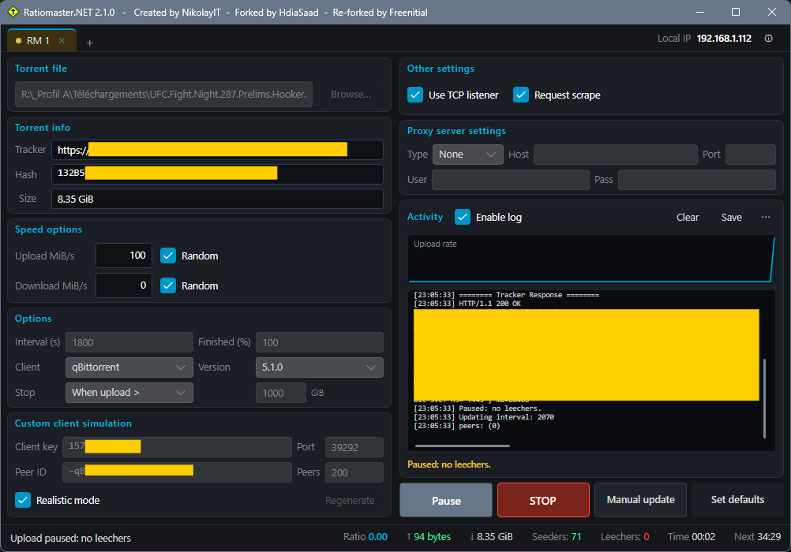

# RatioMaster.NET

A standalone BitTorrent tracker simulator built with Avalonia 12 and .NET 11.



RatioMaster.NET reports simulated upload/download figures to a tracker. No torrent client needs to be installed or running.

## Download

[Download the latest published release](https://github.com/Freenitial/RatioMaster.NET_2.0/releases/latest).

| Platform | Package |
|---|---|
| Windows x64 / ARM64 | Signed Native AOT EXE with statically linked Skia and HarfBuzz |
| Linux x86_64 / aarch64 | Native AOT AppImage |
| Android | APK |
| macOS x64 / ARM64 | Local Native AOT application bundle; build on a Mac |

Local release builds are written to `Installer/Output`. Windows graphics libraries are neither distributed as separate DLLs nor extracted at startup. Windows rendering uses the software backend; ordinary Windows system APIs remain dependencies.

## Quick start

1. Load a `.torrent` using Browse, its path or drag and drop. Several files, a folder (Folder…, Ctrl+Shift+O) or files passed on the command line open one tab each.
2. Select the client profile and set upload/download speeds in **MiB/s** (1 MiB = 1,048,576 bytes).
3. Choose a stop condition and press **START**.

The interface is available in 42 languages. It follows the system language (on Android 13+ also the per-app language of the system settings); the ⓘ panel selects another one, applied immediately. Arabic, Hebrew and Persian are laid out right to left.

Each tab owns its torrent, identity, counters and announce schedule. Like a real client listening on one port for all of its torrents, every tab of one client profile announces the same port: it is drawn once from that client's own range, checked for availability and saved; tabs behind different proxies keep separate ports, and two clients behind one exit never draw the same port (a fixed default port that two clients share, such as Transmission's 51413, is noted in the log). Leave Port and Peers empty for these automatic values (shown in the empty fields), or type a value for one tab. Pause/Resume keeps the identity stable and scheduled tracker updates active.

Announces report the transfer of the current session, as a restarted client does, while the status bar keeps the totals: Downloaded counts only data RatioMaster downloaded, and Done shows the completion. Finished (%) follows the progress reached, so the next start resumes it exactly; a value you type is used as typed. A torrent already open for the same tracker in another tab is reported, and a second session for it is refused: two sessions would look like two peers of one account. Upload also pauses when the tracker reports no leechers and resumes through normal announces; a manual pause remains independent. Random controls remain separate for upload and download.

On Android 17, local trackers, local proxies and incoming LAN peers require the Nearby devices permission. The app requests it when starting a session that needs it. Refusing local peer access still permits public tracker traffic; local trackers or proxies require permission through Android app settings before they can start.

A tracker refusal stops the affected tab, except a refused completed announce (some trackers refuse one sent too early), which is sent again up to three times; a refused scrape only ends scraping. Temporary transport errors preserve pending announce events for retry, a pending completed is sent before stopped when you stop, and stopped is only sent to a tracker that accepted started, as libtorrent and Transmission do. Announce timing follows each client: libtorrent profiles never announce more often than every five minutes and assume a 30-second minimum interval when the tracker sends none, Transmission 120 seconds. Manual update requires confirmation and waits for that minimum interval.

The tracker URL is editable while stopped. Resetting settings preserves the torrent's counters and the other tabs. The status bar colours seeder counts green and leecher counts red and wraps on compact screens.

## Terminal and information panel

The terminal keeps bounded queued traffic and retained text. Thin scrollbars have a larger transparent interaction area and do not expand over the text. The `…` menu provides a filter, copy and a follow toggle. Clear resets the terminal and graph without changing transferred counters; Set defaults also clears both. Copy and Save use displayed lines; clear the filter to export the full retained journal.

The `ⓘ` panel provides local diagnostics, an offline changelog and a manual GitHub update check. Opening it does not contact GitHub. Only a strictly newer stable release is offered, and opening a release page requires a separate click.

Shortcuts: Ctrl+O opens torrents; Ctrl+Shift+O opens a folder of torrents; Ctrl+T adds a tab; Ctrl+W closes the current tab; Ctrl+Enter starts/pauses/resumes; Ctrl+. stops; F5 opens the manual-update confirmation; Ctrl+Shift+C copies the hash. Escape and Android Back dismiss the topmost dialog.

## Saved settings

Windows and Linux portable settings stay beside the executable. For an AppImage, that location is the folder containing the AppImage file, independent of its temporary mount directory. An installation-specific local application-data directory is used if that location cannot be written. macOS keeps settings outside the signed app bundle; Android uses private app storage.

Saves use atomic replacement and a previous-snapshot backup. Setting changes, the interface language, each client's port and the counters (after every accepted announce and before quitting) are preserved. Sessions from earlier versions are migrated: ports and peer counts they filled automatically become automatic again. A session in an ambiguous shared temporary folder is reported and left intact rather than assigned to another installation. Existing custom identities are retained; values whose origin cannot be established are treated as custom.

The default desktop window is 1000 × 668. Its extra height compensates for the larger status bar. Saved desktop layouts receive this adjustment once.

## Client profiles

| Family | Included versions | First-run port |
|---|---|---|
| qBittorrent | 5.2.4 (default), 5.2.3, 5.1.4, 5.1.0, 5.0.3, 4.6.7, 4.6.5 | 1024–65535 |
| µTorrent | 3.6.0 build 47254 | 10000–64999 |
| Transmission | 4.1.3, 4.0.6 | 51413 |
| Deluge | 2.2.0 with libtorrent 2.0.7.0, 2.2.0 with libtorrent 1.2.19.0, 2.1.1 with libtorrent 2.0.6.0 | 49152–65524 |
| BitTorrent | 7.11.0 build 47255 | 10000–64999 |

A client profile represents a particular construction, not every combination of version, platform and library. Profiles built on libtorrent 2 allow pure v2 torrents; Deluge with libtorrent 1.2, Transmission, µTorrent and BitTorrent exclude them, and hybrids can use their v1 identity. A saved tab whose version is no longer emulated moves to the current version of the same client.

Peer IDs remain twenty raw bytes for the handshake and UDP, with profile-specific HTTP escaping: libtorrent leaves `-_.!~*()` unescaped, µTorrent, BitTorrent and Transmission `-._~`. The editable field represents binary IDs as `hex:` followed by 40 hexadecimal digits. µTorrent and BitTorrent IDs end with two check bytes (the start of the SHA-1 of the other eighteen); a custom ID whose length, prefix or check bytes do not match the selected client is reported. Generated µTorrent/BitTorrent keys follow a ten-minute refresh policy; custom keys remain unchanged. Transmission 4.x uses a 32-bit key with eight upper-case hexadecimal digits, libcurl's header order and `Accept-Encoding: deflate, gzip`, and no Connection header.

libtorrent profiles add `ipv4=`/`ipv6=` with the machine's public addresses for private torrents, and Transmission 4.1 for every torrent, as the real clients do. These parameters are never sent through a proxy, which would otherwise reveal the address it hides.

Incoming peers are answered as the emulated client: its reserved bits, extension handshake (`v`, `reqq`, `yourip`, metadata and PEX only for public torrents), availability, DHT port, keep-alives at the client's interval, the metadata of public torrents in 16 KiB pieces, and rejected block requests. Encrypted connections (MSE/PE) are accepted with RC4 or plaintext as the client prefers. The values of the open-source clients come from their sources (libtorrent `bt_peer_connection.cpp`, Transmission `handshake.cc`/`peer-msgs.cc`); µTorrent and BitTorrent are closed source, so their extension handshake follows the family's published conventions and can be adjusted in `clients.json`.

### Optional custom catalogue

A `clients.json` beside the desktop executable, or in the application settings directory on macOS/Android, is read at startup. It extends or overrides built-in family/version pairs without changing active sessions. It uses this application's format, not a directly copied upstream JSON file.

```json
{
  "format": 1,
  "default": "qBittorrent 5.2.4",
  "clients": [
    {
      "family": "qBittorrent",
      "version": "5.2.4",
      "numWant": 200
    },
    {
      "family": "Deluge",
      "version": "2.1.1 (libtorrent 1.2.15)",
      "base": "Deluge 2.2.0 (libtorrent 1.2.19)",
      "peerIdPrefixHex": "2D4445323131732D",
      "headers": [
        "Host: {host}",
        "User-Agent: Deluge/2.1.1 libtorrent/1.2.15.0",
        "Accept-Encoding: gzip",
        "Connection: close"
      ],
      "extensionClient": "Deluge/2.1.1 libtorrent/1.2.15.0",
      "supportsV2": false
    }
  ]
}
```

`base` names a built-in profile. A matching family/version without `base` inherits that built-in definition. A new profile must provide its required fields; `default` must name a profile in the merged catalogue. A profile derived from another version must restate everything that names the version (peer ID prefix, User-Agent, `extensionClient`), as in the example: a mismatch is exactly what a tracker or peer can notice. Profiles retired in 2.3.0 (µTorrent 3.5.5 and 3.5.4, BitTorrent 7.10.3) can no longer serve as `base`.

| Field | Accepted values |
|---|---|
| `httpProtocol` | `HTTP/1.0` or `HTTP/1.1` |
| `headers` | ASCII lines; one `Host: {host}` and one non-empty User-Agent |
| `query` | No leading `?`; required placeholders `{infohash}`, `{peerid}`, `{port}`, `{uploaded}`, `{downloaded}`, `{left}`, `{key}`, `{event}` exactly once |
| `peerIdPrefixHex` | Raw prefix, 1–20 bytes as hexadecimal |
| `peerIdLiteralPrefix` | Declared ASCII prefix retained literally in URLs |
| `peerIdTail` | `libtorrent`, `binary`, `transmission`, `utorrent` (random bytes ending with the µTorrent check bytes); Transmission requires an eight-byte prefix |
| `peerIdByteMinimum`, `peerIdByteMaximum` | Inclusive binary-generator bounds, 0–255 |
| `urlEncoding` | `libtorrent`, `rfc3986`, `alphanumeric` |
| `unreserved` | Instead of `urlEncoding`: the punctuation left unescaped, from `-_.!~*()'` |
| `hashUpperCase`, `peerIdUpperCase` | Case of hexadecimal escape digits |
| `keyLength`, `keyUpperCase` | 1–8 hexadecimal digits and explicit case |
| `keyRefreshSeconds` | 0, or 60–86400; generated keys only |
| `numWant` | 0–200; a query containing numwant must use `{numwant}` |
| `intervalFloorSeconds` | 0–3600; shortest regular interval accepted from a tracker (libtorrent profiles: 300) |
| `defaultMinIntervalSeconds` | 0–3600; minimum interval assumed when the tracker sends none (libtorrent 30, Transmission 120) |
| `supportsV2` | Capability of the represented construction |
| `portRanges` | First-run listening ports, such as `10000-64999` or `51413`; up to 16 ports or ranges |
| `globalAddresses` | `none`, `private` (libtorrent: private torrents) or `always` (Transmission 4.1) |
| `handshakeReservedHex` | The eight reserved handshake bytes as 16 hexadecimal digits |
| `extensionStyle` | `none`, `libtorrent`, `transmission`, `utorrent`; must agree with the extension bit (byte 5, `0x10`) |
| `extensionClient`, `extensionRequestQueue` | The `v` (at most 64 characters) and `reqq` (1–10000) of the extension handshake |
| `encryptionPrefersRc4` | Select RC4 when an encrypted peer also offers plaintext |
| `keepAliveSeconds` | 30–300; idle seconds before a peer keep-alive (libtorrent 60, Transmission 100) |

Limits: UTF-8 with or without BOM, 1 MiB, 128 entries and 16 nesting levels. Unknown/duplicate fields, invalid placeholders, impossible identities and authentication/transport headers are rejected. Compression offers must use supported decoders. Any error rejects the complete external file and retains the built-in catalogue, with a visible diagnostic.

A profile without a Connection header sends none, as libcurl does. The rules draw on [upstream client definitions](https://github.com/NikolayIT/RatioMaster.NET/blob/fa5a815b8384fce44f5d2a60c52898939cf681c1/src/RatioMaster.Core/Clients/clients.json), [libtorrent](https://github.com/arvidn/libtorrent/tree/v2.0.7/src), [Deluge](https://github.com/deluge-torrent/deluge/blob/deluge-2.1.1/deluge/core/core.py) and [Transmission](https://github.com/transmission/transmission/tree/4.0.6/libtransmission). Correct byte formatting and local fixtures do not certify complete client emulation or tracker acceptance.

## Build and validation

Use the .NET 11 RC1 SDK selected by `global.json` (`11.0.100-rc.1.26425.128`). RC1 is an official prerelease with go-live support, not a nightly build. `Directory.Build.props` turns off the SDK's optimized publish pipeline (`UseOptimizedPublish`), which skips Avalonia's XAML compilation: a published window would not open. Avalonia uses stable 12.1.4 with SkiaSharp 3.119.4; Windows x64 and ARM64 share the Optris 3.119.4.1 static software-rendering provider. SkiaSharp 4 is not substituted across the Avalonia/static-library ABI. CommunityToolkit.Mvvm remains on stable 8.4.2.

```sh
dotnet run --project RatioMaster.App
```

The graphical builder can acquire its required toolchains. Headless mode uses installed tools and does not open UAC or installer dialogs:

```bat
Installer\build_RatioMaster_setup.bat
Installer\build_RatioMaster_setup.bat --headless --winx64 --winarm64 --apk --linux
```

Use `--check-tools` for a preflight without compilation, `--aot` for a bare x64 publish, `--aab` for an Android App Bundle and `--nosign` to skip Windows signing. An Android signing keystore can be supplied with `RM_ANDROID_KEYSTORE`, `RM_ANDROID_KEYSTORE_PASS`, `RM_ANDROID_KEY_ALIAS` and `RM_ANDROID_KEY_PASS`; otherwise a debug keystore is used. A debug-signed AAB is not suitable for Google Play.

Published Windows executables carry timestamped Authenticode signatures (SHA-256, RFC 3161). The builder signs them with the code-signing certificate of the current user, whose hardware token asks for its PIN in its own dialog; `RM_SIGN_THUMBPRINT` chooses among several certificates and `--nosign` leaves the files unsigned. `Installer/Scripts/Sign_WindowsExecutables.ps1` signs executables built elsewhere, and with `-VerifyOnly` checks signed ones without the token. Generate distribution checksums after signing.

`Directory.Build.props` centralizes compilation files under `artifacts/`. `Installer/Output` contains the final distribution packages and checksums.

| Location | Contents |
|---|---|
| `artifacts/bin` | Compiled applications, organized by project/configuration/platform |
| `artifacts/obj` | Compiler, restore and native-link intermediate files |
| `artifacts/publish` | Distribution staging; the Windows builder uses one directory per RID |
| `artifacts/logs` | Build and validation logs, plus archived maintenance evidence |
| `Installer/Scripts` | Build and packaging implementation |
| `Installer/Tests` | Packaging and process-runner regression scripts |
| `Installer/Data` | AppImage launcher and desktop-entry source files |
| `Installer/Output` | Final EXE, APK, AppImage and checksum files |

The entry point remains `Installer/build_RatioMaster_setup.bat`. Windows native builds select the latest installed compatible Visual Studio C++ tools, including Build Tools 2026. Android target/minimum API levels come from the project SDK and `SupportedOSPlatformVersion`; packaging does not rewrite the source manifest. A portable application run from a build directory can save `ratiomaster.session` beside itself; preserve those files before clearing build output.

Linux AppImages are compiled on Ubuntu 22.04 (glibc 2.35), the catalog's test baseline. Building Native AOT on a newer distribution can introduce newer libc symbols even when the .NET application is self-contained. Packaging checks the executable, native libraries and AppImage runtime for the correct architecture and a maximum GLIBC_2.35 requirement, then runs the runtime diagnostic on native-host builds. AppImage tools have fixed versions and SHA-256 checksums.

```sh
bash Installer/Scripts/package_linux.sh linux-x64
bash Installer/Scripts/package_linux.sh linux-arm64
```

Use a prepared Ubuntu 22.04 environment with clang, zlib development files, binutils, curl, file, desktop-file-utils and the selected .NET SDK. ARM64 cross-compilation from x64 also requires its cross compiler and development libraries. The Windows builder selects `Ubuntu-22.04`, or the distribution named by `RM_WSL_DISTRO`; prepare it once with `wsl --install -d Ubuntu-22.04 --no-launch`, then, as root, `apt-get install clang zlib1g-dev desktop-file-utils file curl gcc-aarch64-linux-gnu binutils-aarch64-linux-gnu` and the SDK of `global.json` through `dotnet-install.sh --install-dir /root/.dotnet`. Missing prerequisites produce an explicitly labelled self-contained JIT archive; a compilation or ABI failure stops packaging. Headless AppImage packaging requires the verified tools to be cached; the direct Linux script can download them.

On macOS, with Xcode command-line tools:

```sh
bash Installer/Scripts/package_macos.sh osx-arm64
bash Installer/Scripts/package_macos.sh osx-x64
```

This creates a Native AOT `.app`, ZIP and SHA-256 file. Its ad hoc signature is checked locally; it is not Developer ID signing or notarisation. An existing destination bundle is not overwritten.

Regression tests live in `Tests/`, compile only into desktop Debug builds and use local fixtures. They protect protocol handling, saved settings, independent tabs and responsive layouts. `Tests/RequestGoldens.txt` pins, byte for byte, the announce request and the handshake every built-in profile produces: a difference is a change of fingerprint and must be deliberate (regenerate with `RatioMaster.NET --write-request-goldens Tests/RequestGoldens.txt` from a Debug build). Keep them even when feature development slows down:

```powershell
powershell -NoProfile -ExecutionPolicy Bypass -File .\Installer\Scripts\validate_RatioMaster.ps1
```

On Linux/macOS, run the same script with PowerShell 7 (`pwsh`). It builds and executes suites sequentially for the host architecture, isolates temporary data and writes ignored logs under `artifacts/logs/validation`. The GitHub workflow uses separate Windows/Linux/macOS jobs. Do not run builds sharing the same `obj` concurrently.

A small `--runtime-selftest` diagnostic remains in desktop release binaries to check native graphics, embedded release history and serialization without opening sessions or using the network. Compilation and this diagnostic do not replace Android/ARM64 device testing or a macOS run.

## Translations

English texts are written in `RatioMaster.App/Localization/Strings*.cs`, next to their keys; each other language is a flat JSON file in `RatioMaster.App/Localization/Languages/<code>.json`, embedded at build time and loaded on demand (no satellite assemblies, Native AOT and trimming safe). A Debug build exports the English reference with `RatioMaster.NET --export-strings en.json`. The self-tests require every language to contain every key with the same `{0}` placeholders. To add a language, add its JSON file, its entry in `Localization/Language.cs`, `Resources/xml/locales_config.xml` (Android), the localization list of `Installer/Scripts/package_macos.sh` and a `Comment[…]` line in `Installer/Data/RatioMaster.desktop`; the self-tests check that these lists name exactly the offered languages. On Android 13 and later the choice also appears as the app language in the system settings, and a change made there applies at once.

## Release history and credits

See [CHANGELOG.md](CHANGELOG.md) for the full history and [RELEASE_NOTES.md](RELEASE_NOTES.md) for the current release notes.

MIT — see [LICENSE](LICENSE). Originally by [NikolayIT](https://github.com/NikolayIT), HTTPS/TLS work by [HdiaSaad](https://github.com/HdiaSaad), and this fork by Freenitial. Recent upstream development was reviewed and adapted while retaining this fork's tabbed interface and standalone emulation.
